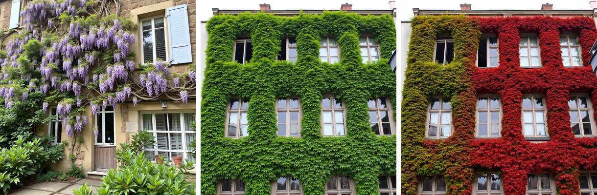
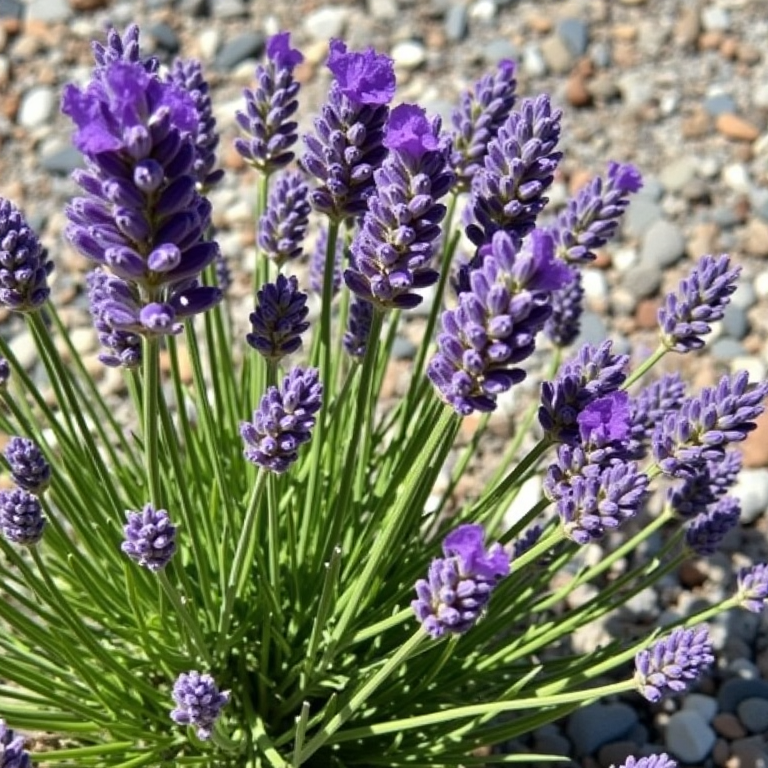

# botanical-flux-mcp

An [MCP](https://modelcontextprotocol.io) server that lets an AI assistant (Claude Code, Claude Desktop, any MCP client) generate **plants by species and by season or growth stage** with **FLUX.1 [dev]** and one fine-tuned **LoKr / LoRA per species**, through **ComfyUI**.

You ask *"wisteria in bloom on a granite house, seed 7"* or *"turn this facade to autumn"*. The server picks the right model, writes the prompt in the vocabulary the model was trained on, builds the ComfyUI workflow and returns the image.


<sub>Left: `generate("wisteria", "bloom")`. Middle and right: `generate("boston_ivy", "summer")`, then `make_autumn()` on that image (same building, only the foliage is repainted).</sub>

## Tools

| Tool | What it does |
|---|---|
| `species()` | Lists the species, their stages / seasons, trigger words and the vocabulary seen in training |
| `generate(species, stage, setting, …)` | One image from scratch (txt2img, about 1 min on a 16 GB GPU) |
| `plant(photo, mask, species, stage, …)` | Grows a species on your own photo, inside the white area of a mask (inpainting); the rest of the photo is pasted back unchanged |
| `make_autumn(summer_image)` | Boston ivy: same facade, summer → autumn. The foliage mask is computed from the green pixels, and the denoise strength works as a "season slider" (1.0 = full autumn, 0.92 = early autumn) |

Species: `wisteria`, `clematis` (*Clematis armandii*), `boston_ivy`, `english_ivy`, `lavender`. French names work too (`glycine`, `lierre`, `lavande`…).

## Why a server and not just a workflow

The models only work well when the prompt reuses the words and the order of their training captions (`glcn_zc, a wisteria vine in bloom, with … pinnate leaves …`). The server keeps that knowledge in one place:

- one entry per species in `SPECIES`, with its trigger, stages, prompt template and defaults;
- settings validated in my training tests: 28 steps, `euler` / `simple`, CFG 1, FluxGuidance 3.5, the training resolution;
- per-species choices that came out of comparisons, for example English ivy uses the LoRA by default, because on wide facades the LoKr tends to draw a tree trunk.

It only uses **core ComfyUI nodes**. The workflow is built in code for each request and sent through the ComfyUI API, so no workflow file or custom node is needed.


<sub>`generate("lavender", "bloom", setting="gravel")`, 768 px. Lavender uses its own close-up prompt template.</sub>

## Setup

1. **ComfyUI** running locally, with:
   - `models/diffusion_models/flux1-dev.safetensors` (FLUX.1 [dev], loaded as fp8);
   - `models/text_encoders/clip_l.safetensors` and `t5xxl_fp8_e4m3fn.safetensors`;
   - `models/vae/ae.safetensors`.
2. **The species models**, from the [Botanical LoRA / LoKr collection](https://huggingface.co/collections/Potiron/botanical-lora-lokr-6adf7e67b920a405a2ed33ee), in `ComfyUI/models/loras/botanical/`, keeping their file names:
   `wisteria_glcn_zc_lokr.safetensors`, `clematis_armandii_clmts_zc_lokr.safetensors`, `boston_ivy_vgn3vrs_zc_lokr.safetensors`, `english_ivy_lrre_zc_lora.safetensors`, `lavender_lvnd_zc_lokr.safetensors`, plus the `_lora` / `_lokr` variant if you want to switch with `model=`.
3. **Python 3.11+**:
   ```
   python -m venv .venv
   .venv/bin/pip install -r requirements.txt        # Windows: .venv\Scripts\pip
   ```
4. **Register the server** in your MCP client.
   - Claude Code:
     ```
     claude mcp add botanical-flux -e COMFYUI_URL=http://127.0.0.1:8188 -- /path/to/.venv/bin/python /path/to/server.py
     ```
   - Claude Desktop (`claude_desktop_config.json`):
     ```json
     { "mcpServers": { "botanical-flux": {
         "command": "/path/to/.venv/bin/python",
         "args": ["/path/to/server.py"],
         "env": { "COMFYUI_URL": "http://127.0.0.1:8188" } } } }
     ```

### Settings (environment variables)

| Variable | Default | |
|---|---|---|
| `COMFYUI_URL` | `http://127.0.0.1:8188` | ComfyUI server (Comfy Desktop uses port 8000) |
| `BOTANICAL_LORA_SUBFOLDER` | `botanical` | subfolder of `models/loras` holding the species models |
| `BOTANICAL_OUTPUT_DIR` | `./outputs` | where generated images are saved |
| `FLUX_UNET`, `FLUX_CLIP_L`, `FLUX_T5`, `FLUX_VAE` | see above | model file names, if yours differ |

Images and masks are sent to ComfyUI and fetched back through its API, so ComfyUI can run on another machine.

## Example requests

- *"Generate wisteria in bloom on a Breton granite house, seed 7"*
- *"Make this facade autumnal: C:/…/facade_summer.png"*
- *"Grow English ivy on my photo C:/…/house.jpg using the mask C:/…/mask.png"*
- *"Lavender foliage on bare soil, medium shot"*

## Adding a species

Add one entry to `SPECIES` in `server.py`: trigger word, name as written in the captions, model file prefix, a prompt template (`CLIMBER` for facades, or your own), the stages with their caption wording, and defaults (framing, light, resolution).

## How it was built

Built with Claude Code. I designed the tools and the pipeline behind them: which model to use for each species, the settings validated by my training tests, the prompt templates taken from my captions, and the foliage mask used for season changes. The code was written by Claude Code under my direction, and I extend it myself.

The models themselves (datasets from iNaturalist / Wikimedia Commons, captions, training with kohya_ss, LoRA vs LoKr comparisons) are documented on their [Hugging Face model cards](https://huggingface.co/collections/Potiron/botanical-lora-lokr-6adf7e67b920a405a2ed33ee).

## License

Code: MIT (see `LICENSE`).
**FLUX.1 [dev] and models derived from it are under the [FLUX.1 [dev] Non-Commercial License](https://huggingface.co/black-forest-labs/FLUX.1-dev/blob/main/LICENSE.md)**: generated images are for demonstration and non-commercial use.
